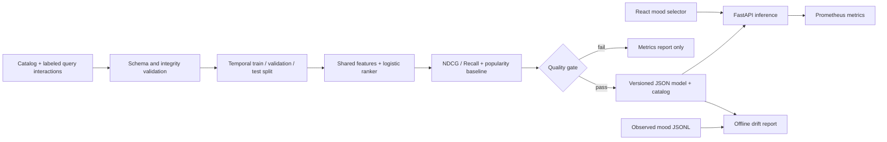

# Resonance — Music Recommendation ML Platform

An end-to-end ML engineering portfolio project: generate and validate data, train a preference ranker,
evaluate against a baseline, publish a versioned artifact, and serve recommendations through an API
and React application. Runs locally without credentials, a camera, or paid infrastructure.

**Demo scope:** all included tracks and interactions are synthetic. The project demonstrates ML
systems engineering; its offline scores do not establish real-world music recommendation quality.
There is no audio playback or Spotify integration in the supported application.

## Architecture



The model learns how audio-feature distances and track attributes relate to relevance. It scores
catalog candidates for a user's selected energy/valence preferences; mood supplies defaults that users
can override through the API. This is a **content-based pointwise ranker**, not collaborative filtering.

## Run locally

Prerequisites: Python 3.11–3.13, [uv](https://docs.astral.sh/uv/), and Node.js 22 for the UI.
Use a checkout path without `#` for Vite (for example `~/Projects/music-ml`). Vite fails to resolve
entry files in paths such as `Desktop/C#/…`; Python commands below use module entry points to avoid
similar executable-script path issues.

```sh
uv sync --frozen
uv run python -m music_ml.cli generate
uv run python -m music_ml.cli validate
uv run python -m music_ml.cli train
uv run python -m uvicorn music_ml.api:app --host 127.0.0.1 --port 8000
```

In a second terminal:

```sh
cd Frontend/Frontend
npm ci
npm run dev
```

Open `http://localhost:5173`. API docs: `http://localhost:8000/docs`.
`make demo` installs dependencies and trains; `make serve` starts the API.

```sh
curl -X POST http://localhost:8000/v1/recommendations \
  -H 'Content-Type: application/json' \
  -d '{"mood":"calm","k":5,"energy":0.3,"exclude_track_ids":[]}'
```

Responses contain ranked fictional tracks, scores, resolved preferences, and a model version.
Scores are uncalibrated relevance estimates, not percentages of listener satisfaction.

For the containerized API, run `docker compose up --build`. The image trains a fixed synthetic demo
model at build time, fails on a quality-gate failure, and runs as a non-root user. The frontend still
runs separately with npm. A production build should consume an approved artifact from a registry
instead of generating demo data. Docker startup can be verified with `python scripts/smoke.py`.

## ML workflow

- **Data contracts:** Pydantic schemas, finite bounded features, unique track IDs and query-track
  pairs, referential integrity, consistent context within each query, and binary relevance labels.
- **Leakage controls:** oldest 60% of distinct timestamps for training, next 20% for validation,
  newest 20% for test. Equal timestamps and whole queries stay together. Scaling fits only training
  rows. Regularization is selected only on validation NDCG.
- **Evaluation:** per-query NDCG@10 and Recall@10, a popularity baseline, and test metrics by mood.
  Queries without positive labels are excluded from ranking metrics and counted explicitly.
- **Quality gate:** test NDCG@10 ≥ 0.65 and ≥ baseline + 0.02. A failed run writes metrics but never
  replaces the serving model. These thresholds suit this synthetic fixture and need reconsideration
  before a real-data experiment; do not tune them repeatedly on a held-out test set.
- **Artifacts:** `artifacts/model.json` contains scaler parameters, coefficients, feature ordering,
  a catalog snapshot, seed, dependency versions, dataset hash, and content-derived model version.
  `artifacts/metrics.json` contains evaluation and validation trials. JSON avoids pickle loading.
- **Reproducibility:** `uv.lock` and `package-lock.json` lock dependencies. The same data and Python /
  dependency environment reproduce the model version. Different runtimes can produce different
  hashes; tests require reproducibility within an environment, not bitwise equality across platforms.

See [data contracts](docs/data-contract.md), [model card](docs/model-card.md), and
[operations](docs/operations.md) for assumptions, real-data integration, and rollback.

## Checks and GitHub Actions

```sh
uv run ruff check .
uv run ruff format --check .
uv run python -m pytest --cov=music_ml --cov-report=term-missing --cov-fail-under=80
npm --prefix Frontend/Frontend run lint
npm --prefix Frontend/Frontend run build
```

| Automation | Checks |
| --- | --- |
| `ci.yml` | Workflow syntax validation, Python 3.11/3.12/3.13 tests and 80% coverage gate, Ruff lint/format, React lint/build, Docker build and live API smoke test |
| `training.yml` | PR/push/manual/weekly data validation, training, baseline quality gate, downloadable model/report and job summary |
| `security.yml` | Python and npm vulnerability audits, CodeQL for Python, TypeScript, and Actions; PR/push/manual/weekly |
| `dependabot.yml` | Weekly Python/uv, npm, Docker, and Actions dependency updates |

Workflows run after you push to GitHub; no deployment credentials are required. CodeQL requires code
scanning availability (public repositories or the relevant GitHub security plan for private repos).
Set these workflow jobs as required checks in repository branch protection after their first run.
Scheduled workflows use the repository's default branch. Model candidates are retained for 30 days;
scheduled jobs test reproducibility on demo data and do not retrain from live traffic or auto-deploy.

See the [local validation record](.github/coverage/README.md) for measured demo results and checks not run locally.

Coverage configuration and the validation record live in `.github/`. `make test` writes
`.github/coverage/coverage.xml`; CI uploads this generated report as a downloadable artifact.

## Project layout

```text
src/music_ml/        data, features, training, artifacts, API, drift, CLI
 tests/             ML integrity, export parity, API, drift, regression tests
 scripts/           live service smoke test
 Frontend/Frontend/ React + TypeScript client
 .github/           CI, model validation, security, dependency updates
 docs/              data contract, model card, operations
```

For a portfolio walkthrough, demonstrate one clean training run, explain why the split prevents
query leakage, inspect the baseline comparison, call the versioned API, and show the quality-gate
failure test. Describe this as a reproducible ML serving prototype, not a deployed personalized
recommendation system.
